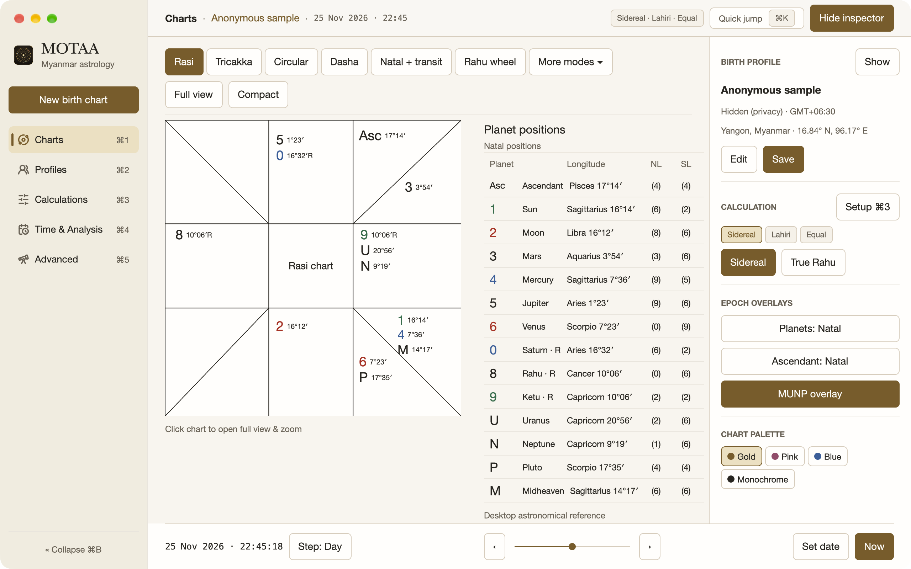
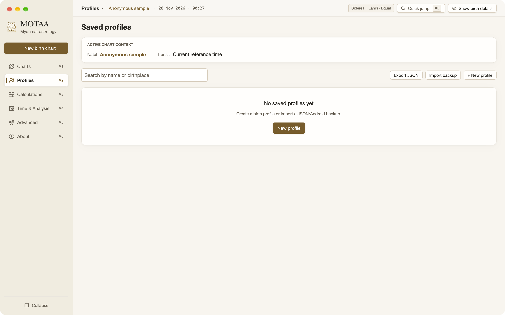

# MOTAA Desktop

MOTAA Desktop is an offline-first Myanmar astrology workspace built with Rust and GPUI. It casts natal and transit charts, manages saved birth profiles, and implements traditional Burmese chart geometry alongside astronomical calculation tools.



## Workspaces & Features

- **Charts (`Cmd+1`)**: 12 chart modes including Rasi, Tricakka, Traditional aspects, Nakshatra traversal, LatLon, Western aspects, Natal + transit, Dasha periods, Circular chart (with 27-nakshatra detail view), Rahu wheel (27/28 divisions), Rasi strengths, and Rasi aspects.
- **Profiles (`Cmd+2`)**: Local SQLite birth profile library with JSON backup export/import, Android v31.1 profile import, interactive date/time picker, 534-town offline Myanmar directory, **OpenStreetMap place search & interactive tile map**, and a **searchable IANA timezone selector** with offline coordinate-to-timezone detection and historical offset preview.
- **Calculations (`Cmd+3`)**: Tropical/Sidereal toggle, Ayanamsha selection, and House system configuration.
- **Time & Analysis (`Cmd+4`)**: Independent transit/reference time and location navigator with live scrubber (`‹` / `›` / `Now`).
- **Advanced (`Cmd+5`)**: 16 tools covering Strength timeline, Ashtakavarga, KP subdivisions, Heliocentric model, Divisional charts, Electional timing, Ephemeris calendar, Eclipses, Daily Tatkalika, Satapati name wheel, Sarvatobhadra, Yoga / candidate times, Interpretations, Transit events, Ten pillars / Ayu Moon, and Nakshatra groups.
- **Quick Jump (`Cmd+K`)**: Keyboard-driven command palette across all modes, tools, profiles, and actions.



## Download

Prebuilt archives with SHA-256 checksums are published on [GitHub Releases](https://github.com/AungMyoKyaw/motaa-desktop/releases):

- **macOS (Homebrew, recommended)**:
  ```sh
  brew install --cask AungMyoKyaw/homebrew-tap/motaa-desktop
  ```
  Installs `MOTAA Desktop.app` for Apple Silicon or Intel and clears macOS quarantine automatically.
- **macOS (Direct ZIP)**: Extract the `.zip` and open `MOTAA Desktop.app`. Bundles are ad-hoc signed and not notarized; Gatekeeper may require approval in **System Settings → Privacy & Security**.
- **Windows x64**: Extract the `.zip` and run `motaa-desktop.exe`. Windows SmartScreen may prompt for the unsigned portable executable.
- **Linux (Ubuntu 24.04 x64)**: Extract the `.tar.gz` and run `./motaa-desktop` in a graphical session with Vulkan support.

### Local Data Paths

- **macOS**: `~/Library/Application Support/MOTAA Desktop GPUI/profiles.sqlite3`
- **Linux**: `$XDG_DATA_HOME/motaa-desktop` or `~/.local/share/motaa-desktop`
- **Windows**: `%LOCALAPPDATA%\MOTAA Desktop`

All calculations and Myanmar town lookups run offline. Network access is only used when you explicitly open **Search OpenStreetMap** or **Pick on map** in a location editor.

## Build from Source

Requires stable Rust, Make, and platform graphics dependencies (Xcode with the Metal toolchain on macOS; see [CONTRIBUTING.md](CONTRIBUTING.md) for Linux/Windows packages).

```sh
make preview   # Explore with an anonymous in-memory sample library
make dev       # Run with your local SQLite profile library
```

| Command | Purpose |
| --- | --- |
| `make check` | Run `cargo fmt --all -- --check` and strict Clippy (`-D warnings`) |
| `make test` | Run all Rust workspace tests (`motaa-desktop`, `motaa-engine`, `motaa-store`) |
| `make smoke` | Run headless GPUI window and interaction verification |
| `make bundle` | Build, sign, and smoke-test `MOTAA Desktop.app` on macOS |
| `make install` | Build and install `MOTAA Desktop.app` to `/Applications` |
| `make ralph` | Run design, build, navigation, and fixture parity checks |

## Calculation Coverage

MOTAA Desktop uses an independent reference ephemeris engine and Myanmar calendar implementation. Verified fixtures are tested against reference oracles, and any unverified or unsupported output is explicitly labeled unavailable. See [docs/gpui/ANDROID_PARITY.md](docs/gpui/ANDROID_PARITY.md) for current coverage.

## License & Privacy

- **License**: GNU Affero General Public License v3.0 (AGPL-3.0) — see [LICENSE](LICENSE). Third-party licenses and attributions live in [third_party/](third_party/).
- **Privacy**: Local-first storage with no telemetry — see [PRIVACY.md](PRIVACY.md) and [SECURITY.md](SECURITY.md).
- **Windows Store Packaging**: MSIX manifest, store assets, and submission instructions live in [packaging/windows/STORE_SUBMISSION.md](packaging/windows/STORE_SUBMISSION.md).
